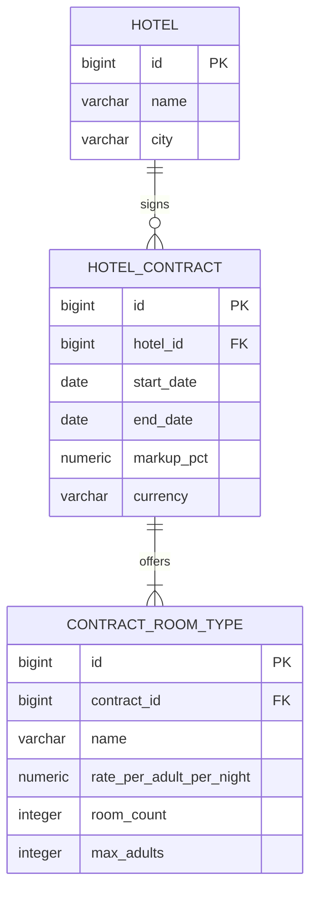

# Design and verification

## ER diagram

The app saves an agreement and its room rows in one transaction. For search, SQL retrieves room types from contracts that cover the date range. The service compares each offer with the requested room count and highest occupancy of any requested room. The quote multiplies the rate by total adults, nights, and `1 + markup / 100`. It rounds once at the end and returns the exact decimal as a string.

## REST endpoints

| Method and path | Result |
| --- | --- |
| `GET /api/hotels` | List hotels for contract entry. |
| `POST /api/hotels` | Add a hotel from `name` and optional `city`. |
| `GET /api/contracts` | List saved agreements. |
| `GET /api/contracts/{id}` | Open one agreement and its room types. |
| `POST /api/contracts` | Save an agreement and any room types in the request. |
| `POST /api/search` | Quote a stay by `checkInDate`, `numberOfNights` and `rooms` with an `adults` value per room. |

## User stories

- As a contract manager, I can save and reopen an agreement with separate rates, allocations and limits for each room type.
- As a call center agent, I can search with different adult counts across rooms and quote the total cost for the whole stay.
- As a call center agent, I can explain when a room type cannot satisfy a search because of occupancy or allocation.

## Acceptance cases

Start with the demo contract or add equivalent rates and dates through the contract form. Compare each observed result with the table.

| Case | Action | Expected result |
| --- | --- | --- |
| Contract creation | Add a hotel, then save a contract with two room types. Refresh the detail page. | Both room types and their exact rates persist. |
| Required values | Enter an end date before the start date or duplicate a room type with different capitalization. | The contract is rejected and does not appear in the list. |
| Basic quote | Request one room with two adults for three nights at the demo Standard rate. | Available at USD 241.50. |
| Room occupancy | Request two rooms with two and one adults for three nights. | Standard at USD 362.25 and Sea View at USD 569.25. |
| Room limit | Repeat with three adults in Room 1 and one in Room 2. | Standard reports the adult limit. Sea View remains available. |
| Allocation | Search for 16 rooms with one adult in each. | Standard reports insufficient rooms. |
| Date boundary | Search December 31, 2027 for one night and then two nights. | The first search returns offers. The second returns no contract. |
| Invalid request | Try zero nights or zero adults. | The form reports invalid input. The REST API also rejects the request. |

Run the Java test suite and compile Angular, then execute the cases above from the browser. Record the observed result and date for each case and fix any mismatch before submission.
